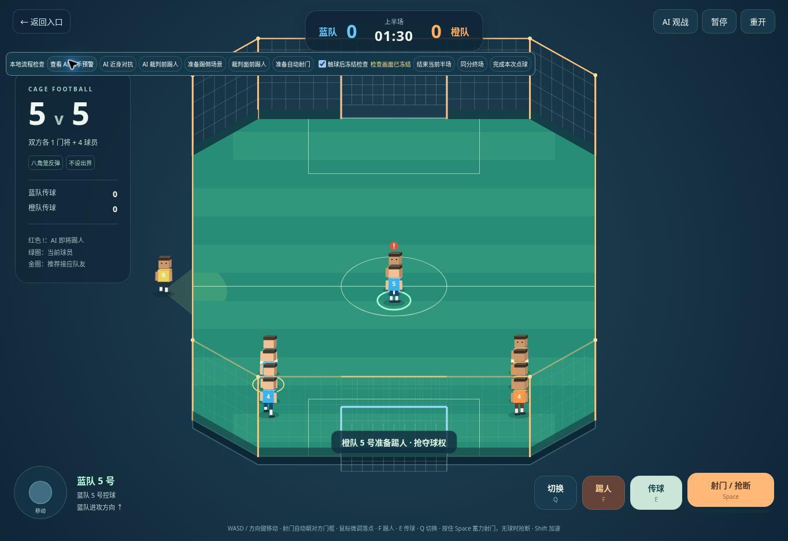
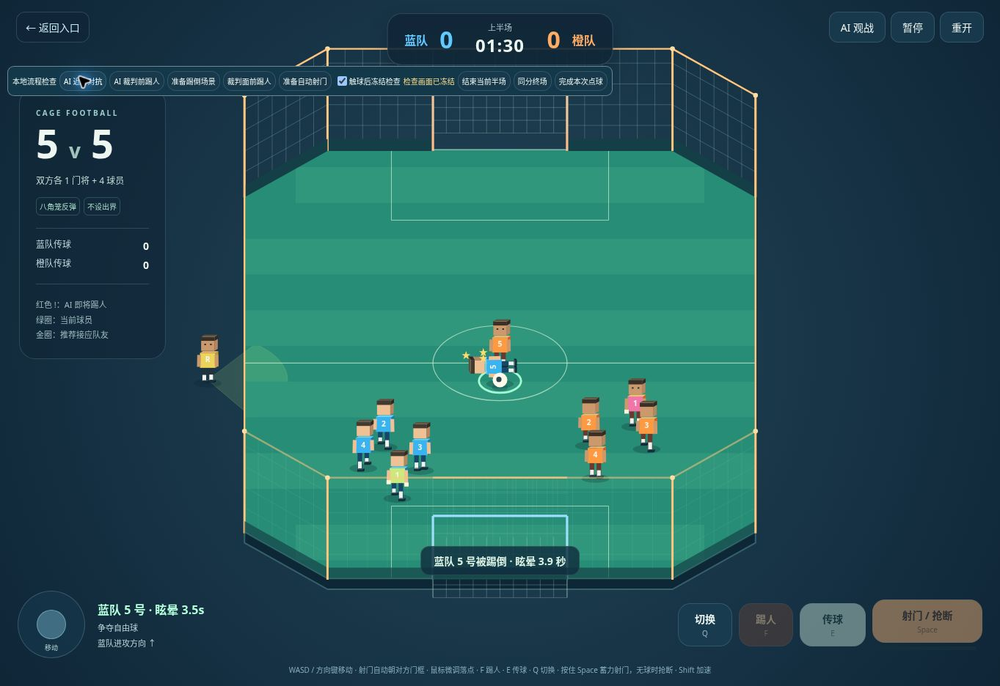

# AI 主动踢人意图

2026-11-12，在上一轮踢倒 / 眩晕基础上接入 AI 决策。

## 覆盖范围

- 5v5 橙队、蓝队 AI 队友，以及开启「AI 观战」后的蓝队当前球员，都能自主踢人。门将仅在自己门前有近身持球威胁时尝试。
- 单人挑战的门将、困难模式后卫同样会主动出手；简单模式门将更谨慎。
- 玩家手动控制的球员不会自动打人。接管蓝队或切换到该球员时，取消 AI 尚未触球的踢人动作。

## 意图与节奏

AI 优先处理足球。遇到附近对方持球者、有人逼抢自己或队友时，才考虑「抢夺球权」「阻止射门」「摆脱逼抢」「保护队友」。不会追打远处或无关的球员。清晰射门机会、快速来球扑救优先；暂停、开球、进球庆祝、换边及点球大战不产生攻击决策。

- 每隔约 0.45–0.8 秒思考，不按画面帧数重复掷概率。
- 观察距离约 1.8 米，意图最多持续 1.2 秒。出手前至少预警 0.22 秒，再经过 0.14 秒出脚触球阶段。
- 头顶出现红色 **!**，可提前移动闪避；足球 / 对手离开后取消追打，已经出脚时也仍需真实近身才能命中。
- 每名 AI 出手后冷却 6–9 秒，同队两次 AI 出手至少间隔 3.2 秒。被击倒者起身后额外保护 1.2 秒，避免连续眩晕。
- 裁判看得见时明显降低出手意愿；门前紧急情况仍可能冒险，被裁判看到照常吹罚。

随机数由独立、可复现的 AI 状态维护，不占用原射门和点球的随机序列。正常传球、跑位、抢断及扑救逻辑保留。

## 命中与判罚

5v5 复用正式踢人动作、触球距离检查、倒地眩晕、释放球权和任意球。AI 命中玩家会取消玩家尚未完成的蓄力 / 射门，眩晕期间不能出脚，但可按 Q 切换队友。界面显示眩晕倒计时和起身状态。AI 犯规时任意球归受害方，蓝队也可以获得任意球，不再固定显示橙队。

单人挑战新增玩家倒地、星星、起身和受击保护。AI 击倒玩家不会消耗五次机会；若被裁判看到，会吹停并把球交还玩家继续进攻。重开或切换离开困难模式会清理后卫未完成的 AI 出脚，防止隐藏后仍伤人。

## 实现与验证

- `scripts/game/combat-ai.js`：共用的威胁判断、攻击意图、独立随机数与冷却。
- `scripts/five/engine.js`：双方 AI 移动、出脚、眩晕与对称判罚。
- `scripts/game/single-combat.js`：单人门将 / 后卫适配、玩家受击及 AI 犯规恢复。
- `scripts/game/ai-warning.js`、`scripts/five/canvas-view.js`：三维及兼容画面的红色预警。

**74 项测试通过**：原 61 项回归，加本轮 13 项，覆盖近身自主出手、双方 / 队友公平能力、门将保护、手动球员不乱打、接管取消、闪避无远程击倒、眩晕保护、AI 可见犯规、蓝队任意球、单人受击恢复与不扣机会、降难度取消待触球动作，以及完整比赛仍有传球射门。

5 个种子的完整 AI 比赛中，每队 63–77 次传球、6–18 次射门、2–9 次踢倒，均正常结束。数据来自模拟测试，不是胜负保证。

浏览器在本地 `five-a-side.html?review=1` 中仅摆放位置，未按玩家踢人键，实际观察了 AI 自主出手、蓝队眩晕、Q 切换队友，以及 AI 在裁判前犯规后蓝队获得任意球。预警检查按钮推进真实模拟到首次意图后冻结，以便观察红色 !；正式站点没有这些检查按钮。

390×844 竖屏和 844×390 横屏中已检查眩晕文字、动作按钮禁用和队友切换。

当前浏览器禁用 WebGL，画面验收使用相同比赛模拟的 Canvas 兼容模式；GPU 和手机实机未验收。

