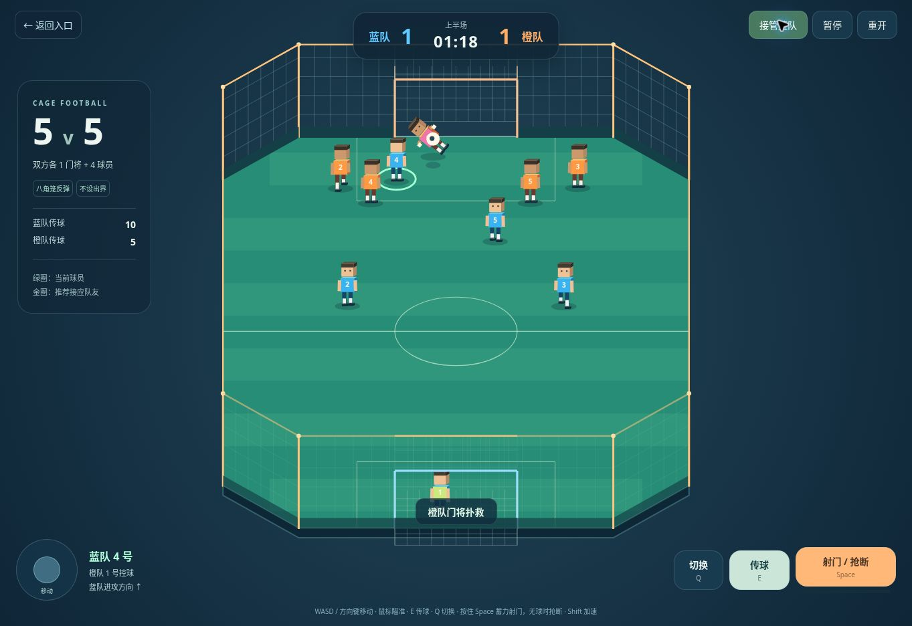
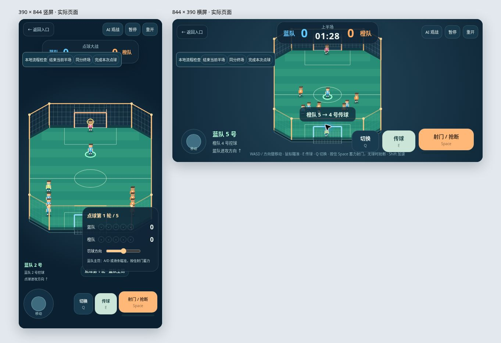

# 5v5 八角笼足球

2026-11-12。在首页新增「5v5 八角笼足球」入口，原挑战模式也可进入，新模式与原挑战的计分、难度及裁判逻辑独立。

## 比赛规则

- 蓝队和橙队各 5 人：1 名门将、4 名场上球员。单人控制蓝队当前球员，其余队友和对手由 AI 控制；可切换 AI 观战，随时接管。
- 上下半场各 **90 秒有效比赛时间**。开球、进球庆祝、中场休息和暂停不计时；中场交换进攻方向，由橙队开下半场。
- 进球后失球队开球。球必须完整越过门线且在门框内才计分，同次进球只计一次。
- 八条笼壁（包括四个斜角）反弹足球，顶部限制高球，球门外、横梁以上均反弹，无边线球、角球或球门球。球门柱有碰撞，球员始终留在笼内。
- 常规时间相同则双方各罚完整 **5 次**点球，即使提前拉开差距也完成五轮。仍平则成对逐轮加罚，双方同轮完成后才判断胜负。点球成绩独立显示，不混入常规比分。
- 点球轮换五名主罚球员，蓝队主罚时可瞄准和蓄力，橙队主罚时由玩家控制蓝队门将移动、扑救。结果由球的实际飞行和门将接触决定。

## 操作

| 操作 | 电脑 | 手机 |
| --- | --- | --- |
| 移动 | WASD / 方向键 | 左侧摇杆 |
| 加速 | Shift + 移动 | — |
| 传球 | E，鼠标指向接应方向 | 传球按钮 |
| 切换球员 | Q | 切换按钮 |
| 射门 | 按住 Space 蓄力，自动朝对方门框 | 按住射门按钮后松开 |
| 踢人 | F，近身踢倒对手 | 踢人按钮 |
| 抢断 | 无球时 Space | 无球时射门 / 抢断按钮 |
| 点球瞄准 | A / D、鼠标或滑条 | 方向滑条 |
| 点球守门 | A / D 横移，Space 扑救 | 摇杆横移，射门按钮扑救 |
| 暂停 | Esc / 暂停按钮 | 暂停按钮 |

绿圈表示当前控制球员，金圈推荐接应者。传给场上队友时自动切换控制；门将拿球后会传出，队友可以回传。AI 通过传球线路、方向和压力选择接应点，进攻时拉开宽度并前插，防守时由最近球员压迫，其他队员覆盖空当。抢断有距离、高度、出脚时间和冷却限制。

## 实现

- `scripts/five/engine.js`：不依赖 Three.js 的固定步长比赛模拟，包括十名球员、AI、球、笼壁、计时、换边、点球和统计。
- `scripts/five/main.js`：键盘、触屏、暂停、界面和固定 1/60 秒主循环。
- `scripts/five/webgl-view.js`：三维八角笼、双队号码和门将。复用 `3D_AItool / Prompt2Rig` 先前已生成的出脚与扑救动作及原游戏身体；新模式用轻量方块头，避免同时载入十个大头模型。
- `scripts/five/canvas-view.js`：无 WebGL 时的可玩投影画面，与三维版本使用完全相同的模拟和比赛结果。
- `scripts/game/assets.js`：只新增可选的号码、短裤配色、名字牌和模型头开关，原调用保持默认行为。
- `five-a-side.html`、`styles/five-a-side.css`：独立入口与响应式界面。

生产站点不开放流程检查按钮。在 `localhost` 或 `127.0.0.1` 访问 `five-a-side.html?review=1` 可使用「结束当前半场」「同分终场」「完成本次点球」检查流程。最后一项加速真实模拟至本次结果，不直接伪造进球。点球结果保留 1.4 秒再进入下一位主罚。

## 验证

执行：

```sh
AXING_THREE_ROOT=/path/to/three-r160/package npm test
```

共 **48 项通过**：原挑战的 35 项回归测试，以及本模式的 13 项测试。覆盖双方人数、90 秒时钟、暂停及换边、八面反弹、高球回场、实际传球和控制切换、延迟出脚、进球只计一次、常规胜负、五轮完整点球、逐轮加罚、点球结果停留、实际飞行扑救、整场双方 AI 配合及重开复位。

浏览器实测：首页入口进入、开球、双方 AI 传球、暂停、下半场换边与 01:30 时钟、蓝队主罚与守门界面、五次点球记录和最终结算。通过真实 iframe 视口检查 390×844 竖屏与 844×390 横屏；竖屏点球面板放在下方，避免挡住主罚球门。

当前浏览器禁用 WebGL，截图与交互验收使用可玩 Canvas 兼容画面；三维 GPU 渲染及移动设备实机尚未验收。





2026-11-12 后续已加入自动朝对方门框射门、F 踢人 / 眩晕、场外裁判吹罚任意球及每次进球撒花。最新规则与 61 项验证见 [自动射门与踢倒说明](GOAL_ASSIST_AND_FOULS.md)。
