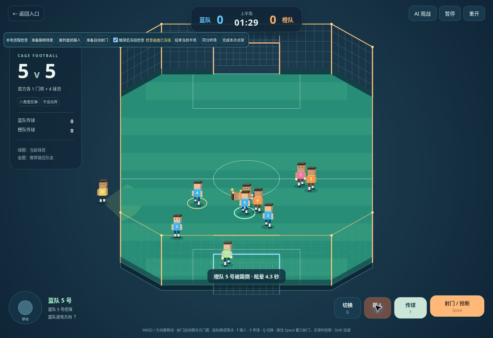
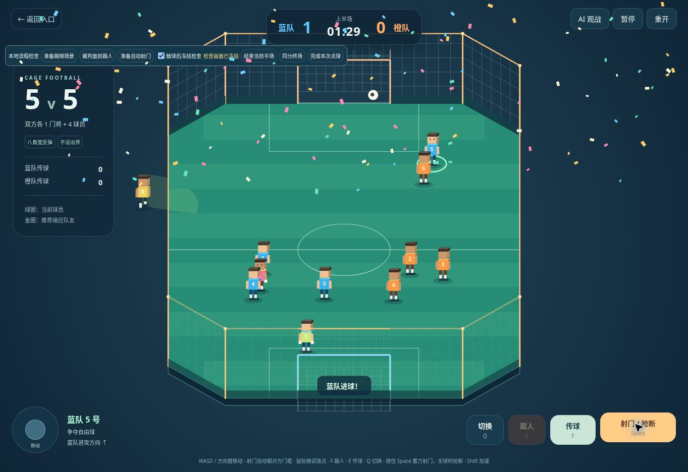
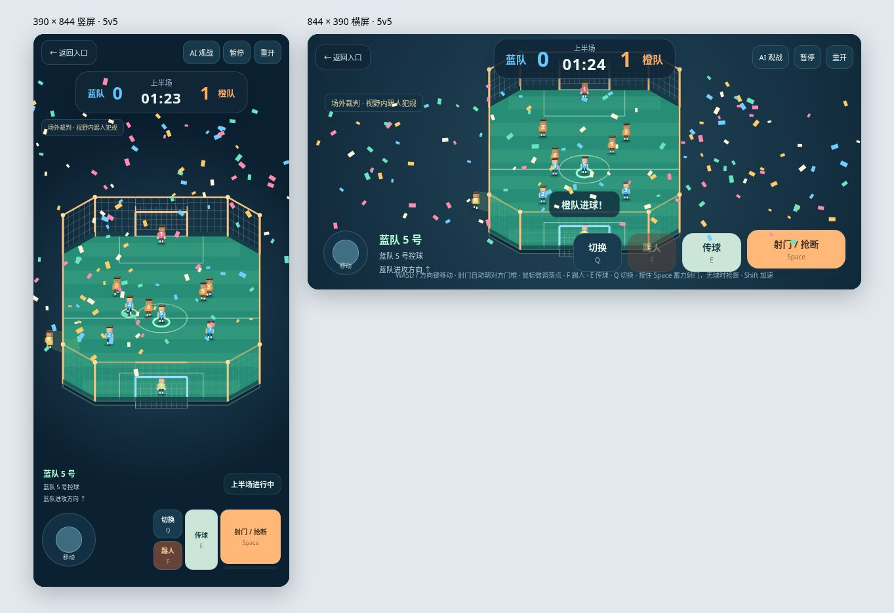

# 自动射门、踢倒眩晕、场外裁判与进球撒花

2026-11-12，接在 5v5 模式之后。

## 操作与行为

| 功能 | 单人挑战 | 5v5 单人控制蓝队 |
| --- | --- | --- |
| 射门 | 按住 Space 蓄力，自动朝唯一对方球门 | 按住 Space 蓄力，按当前半场自动识别对方球门 |
| 鼠标 | 只微调门内横向落点 | 传球仍按指向选择队友，射门只微调门内落点 |
| 踢人 | 按住 F 蓄力，踢倒附近门将或困难模式后卫 | F 或「踢人」按钮，踢倒附近对方球员或门将 |
| 眩晕 | 保留 3–5 秒倒地，随后用 0.6 秒起身 | 4.3 秒倒地，0.6 秒起身；暂停期间计时冻结 |
| 裁判 | 固定在左侧边线之外巡逻；看见踢人按原规则记犯规失败 | 八角笼外左侧巡逻；看见踢人吹停 1.4 秒，再由对方站立球员开任意球 |
| 撒花 | 每次实际进球触发，获胜画面保留庆祝 | 双方实际进球和点球命中均触发 |

射门与踢人已分开：Space 靠近门将时也优先射门，F 才执行踢人。手机有独立踢人按钮。普通无球抢断沿用 5v5 的 Space 操作。

## 射门辅助

`goal-aim.js` 只计算球门方向及横向落点，不改变足球的正常碰撞、速度或门将判断。鼠标留在身后、面朝本方球门或中场换边后，射门仍朝对方球门。

目标留出球半径和门框余量，并同时约束球体前后两端穿过门线时的横向位置。修复了从侧翼瞄准门内、却先撞到门前笼壁的情况。极近底线的极小角度、球门柱、封堵和扑救仍受物理模拟影响。单人挑战保留远近脚射门的高低变化，并限制射门抛物线顶点，避免普通辅助射门直接飞过横梁。

## 眩晕与裁判

- 踢人必须在约 1.08 米范围内，出脚动作到接触帧才生效；对方已经离开时不会远程踢倒。重复按键受动作冷却约束，不能反复延长同一次眩晕。
- 倒地后取消球员尚未完成的出脚或扑救，球权释放。倒地球员不能跑位、接传球、抢断、射门或扑救，队友不会选择他作为接应点。起身后恢复 AI。
- 三维模型与 Canvas 兼容画面均显示倒地、起身和旋转金色星星。
- 裁判模型在场外，巡逻不会横穿球场；绿色扇形与检测仍共用此前缩小后的半径 **2.5**、半角 **55°**。裁判没有看见的踢人只造成眩晕，视野内则吹罚。
- 5v5 犯规停表、取消出脚和球的运动，由被侵犯方其他未眩晕球员重新开球，不改变比分。中场、进球后重新开球及点球准备会清理上一回合的眩晕。暂停不会消耗眩晕时间。

## 撒花

`confetti.js` 在独立 Canvas 上短时渲染彩纸，每次进球触发一次，约 4.4 秒内完全清理；不捕获触屏、鼠标输入。减少动态效果设置下使用较少彩纸，重开清空粒子，暂停冻结动画。单人挑战的撒花画布已移出胜利弹层，未获胜的普通进球也可见。

## 验证

**61 项测试通过**，包含原来的 48 项回归与本轮 13 项。新增覆盖：两半场、两侧、背向鼠标的自动射门；左右侧翼实际穿过门框；单人射门宽度及高度；触球帧踢倒、闪避、释放球权、眩晕恢复和暂停；倒地无法扑救或接球；场外裁判可见犯规、停表与任意球；单人后卫 / 门将眩晕和取消旧动作；每个真实进球只触发一次庆祝；彩纸有限生命周期与不同帧率。

浏览器通过本地 `five-a-side.html?review=1` 的检查按钮摆放测试位置，再使用正式的「踢人」和「射门」按钮实测。可选择在触球后冻结画面以观察姿势；生产站点不显示这些检查工具。实际确认：踢倒与星星、裁判吹罚及后续任意球、侧翼射门真实得分、144 片彩纸触发、390×844 / 844×390 视口的控件布局。

当前浏览器禁用 WebGL，视觉验收使用与三维场景共用比赛模拟的 Canvas 兼容画面；三维 GPU 及移动设备实机尚未验收。

